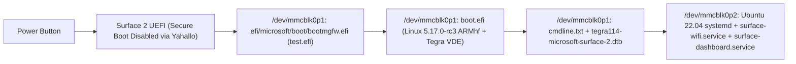

# Microsoft Surface 2 (Tegra 4) — Ubuntu 22.04 Internal eMMC & Smart Display Runbook

> [!IMPORTANT]
> This document captures every hardware quirk, Device Tree (DTB) fix, `systemd` service fix, and boot configuration required to convert a stock **Microsoft Surface 2 (Model 1572, NVIDIA Tegra 4 T114, 32-bit ARMv7, 2 GB RAM, 32 GB eMMC)** from Windows RT 8.1 into a standalone **Ubuntu 22.04 LTS Smart Display Appliance** booting directly from internal eMMC (`/dev/mmcblk0`) with zero external USB or MicroSD media.

---

## 1. Architecture & Partition Layout (`/dev/mmcblk0`)

The internal 32 GB eMMC (`/dev/mmcblk0`) uses an MBR (`msdos`) partition table with two partitions:

| Partition | Size | Filesystem | Mount Point | Purpose |
| :--- | :--- | :--- | :--- | :--- |
| `/dev/mmcblk0p1` | `128 MB` | `FAT32` (`vfat`) | `/boot/efi` | UEFI Boot Partition (`bootarm.efi`, `bootmgfw.efi`, `bcd`, `boot.efi`, `cmdline.txt`, `tegra114-microsoft-surface-2.dtb`) |
| `/dev/mmcblk0p2` | `~29.0 GB` | `ext4` | `/` | Ubuntu 22.04 LTS (`jammy`) ARMhf root filesystem + Smart Display Appliance stack |

### Boot Chain Flow


---

## 2. Critical Hardware & Device Tree (DTB) Fixes Discovered

We encountered and solved five major hardware/kernel pitfalls on the Surface 2 (`Tegra 114`):

### Fix 1: Keeping the 1080p Internal DSI Panel (`samsung,106hl02`) On
- **Symptom:** Booting the `5.17.0-rc3-next-20220207` (`7,508,480`-byte `boot.efi`) kernel with the `2024-09-30` Open-RT DTB (`22,542` bytes) caused the screen to turn black ~1 second into kernel boot (`[0.98s] drm: tegradrmfb`).
- **Root Cause:**
  1. The `2024-09-30` DTB changed `/host1x@50000000/dsi@54300000/panel@0:reset-gpios` from `<0x05 0x56 0x00>` (`GPIO_ACTIVE_HIGH` on GPIO 86) to `<0x05 0x6c 0x01>` (`GPIO_ACTIVE_LOW` on GPIO 108). Because `panel-samsung-106hl02` in `boot.efi` calls `gpiod_set_value_cansleep(reset_gpio, 1)` assuming active-high logic, marking GPIO 108 `GPIO_ACTIVE_LOW` (`0x01`) inverted the signal to physical `0` (LOW), holding the LCD panel in hardware reset!
  2. The `2024-09-30` DTB also removed `regulator-always-on; regulator-boot-on;` from `/i2c@7000d000/pmic@58/pmic/regulators/ldoln` (the 1.8V MIPI DSI PLL supply) and changed `/backlight:pwms` period from `100000` ns (10 kHz) to `1000000` ns (1 kHz).
- **Solution:** Start from the `2024-04` eMMC DTB (`dtb-21906.dtb`, which keeps `panel@0:reset-gpios = <0x05 0x56 0x00>`, `/backlight:pwms = <0x1a 0 100000>`, and `ldoln` always-on), which keeps the 1080p display and Type Cover working reliably.

### Fix 2: Eliminating `irq 96: nobody cared` / `Disabling IRQ #96`
- **Symptom:** ~23 seconds into boot, the kernel hung for several seconds and printed `irq 96: nobody cared ... Disabling IRQ #96`.
- **Root Cause:** `/proc/interrupts` revealed `96: 100001 GPIO 146 Level tps65090`. The `pmic@48` (`ti,tps65090`) node under `/i2c@7000d000` had `interrupt-parent = <0x05>` and `interrupts = <0x92 0x04>` (GPIO 146 active-low level interrupt) plus a `charger` subnode whose unacknowledged charger status bit held GPIO 146 asserted continuously.
- **Solution:** Remove `interrupt-parent`, `interrupts`, and the `charger` child node from `/i2c@7000d000/pmic@48`. All `tps65090` power rails (`dcdc1`–`dcdc3`, `fet1`, `fet4`, `fet6`, `ldo1`, `ldo2`) continue operating normally via I2C without the IRQ storm.

### Fix 3: Preventing Unused Regulator Shutdown (`vdd-ao`, `rail-3v3`, `rail-5v0`, `usb2_vbus`, `what_ever`)
- **Symptom:** ~30–60 seconds after kernel boot, `regulator_init_complete_work` disables any PMIC regulator not claimed by a driver or marked `regulator-always-on`, cutting power to the Marvell Wi-Fi rail or USB VBUS.
- **Solution:** Add `regulator-always-on` and `regulator-boot-on` to:
  - `/i2c@7000d000/pmic@48/regulators/dcdc3` (`vdd-ao`)
  - `/i2c@7000d000/pmic@58/pmic/regulators/regen1` (`rail-3v3`)
  - `/i2c@7000d000/pmic@58/pmic/regulators/regen2` (`rail-5v0`)
  - `/regulator-usb3` (`usb2_vbus`)
  - `/what_ever` (`GPIO 0x3a` Wi-Fi rail)

### Fix 4: `systemd` Default `wpa_supplicant.service` Conflict & `Type=forking` 90s Timeout
- **Symptoms:**
  1. On first eMMC `systemd` boot, `mwifiex_sdio` loaded (`mlan0`), but `wpa_supplicant` failed to associate to Wi-Fi.
  2. When `surface-wifi.service` was configured as `Type=forking`, `systemd` killed `wpa_supplicant` and `dhclient` exactly **90 seconds** after boot (`TimeoutStartSec=90s`) because the background keepalive subshell inherited open file descriptors from `surface-online.sh`.
- **Solutions:**
  1. Mask the default unconfigured Ubuntu `wpa_supplicant.service`:
     ```bash
     rm -f /etc/systemd/system/multi-user.target.wants/wpa_supplicant.service
     rm -f /etc/systemd/system/dbus-fi.w1.wpa_supplicant1.service
     ln -sf /dev/null /etc/systemd/system/wpa_supplicant.service
     ```
  2. Configure `/etc/systemd/system/surface-wifi.service` with `Type=simple`, `Restart=always`, and `KillMode=process`, and keep the `while true` watchdog loop in the foreground of `/usr/local/bin/surface-online.sh` (plus disable Marvell Wi-Fi power save via `iw dev mlan0 set power_save off`).

### Fix 5: Fast Boot & Continuous Visible Boot Text (`cmdline.txt`)
- **Symptom:** Booting from USB showed `"using DTB from command line"` for ~45 seconds (while UEFI loaded the 43 MB `initrd.gz` over USB 2.0), followed by a quiet screen.
- **Solution:**
  - Booting directly from `/dev/mmcblk0p1` into `/dev/mmcblk0p2` uses **no `initrd.gz`**, so `"using DTB from command line"` finishes in **< 1 second**.
  - Set `/boot/efi/cmdline.txt` to:
    ```text
    dtb=tegra114-microsoft-surface-2.dtb root=/dev/mmcblk0p2 console=tty1 consoleblank=0 loglevel=7 systemd.show_status=true cpuidle.off=1 rootwait rw
    ```
  - Configure `/etc/issue` to display the live `mlan0` IPv4 address (`\4{mlan0}`) and login instructions right on `tty1`.

---

## 3. Step-by-Step Procedure for a New Surface 2

### Phase 1: Unlock Secure Boot in Windows RT 8.1 (One-Time per Device)
1. Format a USB drive as **FAT32** and copy the `unlock-usb/` toolkit onto it.
2. Boot the Surface 2 into Windows RT 8.1, plug in the USB drive, and run as Administrator:
   - `1_Install_Golden_Keys.cmd` (installs the Golden Keys into the registry)
   - `2_Enable_TestSigning.cmd` (enables `testsigning` in BCD and reboots)
   - After reboot, run `3_Run_Exploit_and_Disable_SecureBoot.cmd` (triggers `Yahallo.efi` on next reboot)
3. On the blue UEFI Secure Boot prompt, select **Disable Secure Boot** (press **Volume Down** to confirm).

### Phase 2: Boot the Automated USB-to-eMMC Ubuntu 22.04 Installer
1. On your Linux workstation, create `/home/dxm/surface2-wifi.conf` (kept private, `chmod 600`, never committed to git):
   ```bash
   WIFI_SSID="Your_WiFi_SSID"
   WIFI_PASSWORD="Your_WiFi_Password"
   ```
2. Run [`build-surface2-installer.sh`](file:///home/dxm/surface2-revival/scripts/build-surface2-installer.sh) to generate `surface2-ubuntu22-installer.img` (which embeds the Golden DTB `dtb-21906-final.dtb`, the clean Ubuntu 22.04 rootfs tarball, and your local `surface2-wifi.conf` + `~/.ssh/id_ed25519.pub`).
3. Flash `surface2-ubuntu22-installer.img` to a USB drive (or mount via GLKVM virtual USB storage).
4. With the Surface 2 powered off, hold **Volume Down**, press and release **Power**, and release **Volume Down** at the Surface logo.
5. The USB installer automatically:
   - Partitions `/dev/mmcblk0` (`128 MB` FAT32 `mmcblk0p1` + `29 GB` ext4 `mmcblk0p2`)
   - Installs `boot.efi`, `efi/boot/bootarm.efi`, `efi/microsoft/boot/bootmgfw.efi` (`test.efi`), `efi/microsoft/boot/bcd`, `cmdline.txt`, and `dtb-21906-final.dtb` (`tegra114-microsoft-surface-2.dtb`) onto `/dev/mmcblk0p1`
   - Extracts the Ubuntu 22.04 rootfs + Smart Display Appliance stack onto `/dev/mmcblk0p2`
   - Injects your Wi-Fi credentials (`/etc/wpa_supplicant/wpa_supplicant.conf`) and SSH public key (`/root/.ssh/authorized_keys`)
   - Reboots directly into the internal 32 GB eMMC (`Ubuntu 22.04 LTS`).

---

## 4. Smart Display Appliance & Terminal/Dashboard Switching

Once booted into Ubuntu 22.04 from internal eMMC, the Surface 2 runs the Smart Display Appliance stack (matching the Intel Compute Stick architecture):
- **1080p Smart Display Dashboard (`surface-dashboard.service`):** Renders live clock, system metrics, battery status, Wi-Fi/Tailscale IP, and streaming instructions via `cage` + `mpv` (with Tegra VDE `/dev/video0` hardware H.264 acceleration).
- **Apple AirPlay Receiver (`uxplay.service`):** Advertises `Surface2` on the LAN for Mac/iPhone/iPad screen mirroring; automatically yields the display when an AirPlay client connects and restores the dashboard on disconnect.
- **Web Controller & RTSP Cast API (`http://<surface2-ip>:8080`):** Cast any RTSP/HTTP video stream via browser or `curl "http://<ip>:8080/play?url=rtsp://..."`.

### Dropping to the Terminal (`tty1`), On-Screen Touch Keyboard, and Relaunching the Dashboard
- **To Exit the Dashboard to the Terminal (`tty1`):**
  1. **Touchscreen:** Tap the **`[ Terminal / Shell (tty1) ]`** button in the top-right corner of the 1080p dashboard.
  2. **Keyboard:** Press **`q`** or **`Esc`** on the Surface Type Cover (or GLKVM / USB keyboard).
  3. **Web / SSH:** Click **Drop to Terminal (tty1)** in the Web UI (`http://<ip>:8080/terminal`) or run [`dashboard`](file:///home/dxm/surface2-revival/appliance/dashboard) `stop`.
- **Automatic On-Screen Touch Keyboard (`surface-touch-kbd.service`):**
  - Whenever you drop out of the Dashboard to `tty1`, [`surface-touch-kbd.py`](file:///home/dxm/surface2-revival/appliance/surface-touch-kbd.py) automatically starts at the bottom of the screen (`y = 630..1080`) and resizes `tty1` to 38 rows (`TIOCSWINSZ`) so terminal text never overlaps the keyboard.
  - Reads touch coordinates from the Atmel maXTouch touchscreen (`03EB:843C`, `ABS_X/Y 0..4095`) and injects characters and ANSI sequences directly into `/dev/tty1` via `TIOCSTI`.
  - Includes a top quick-action bar with one-tap buttons: **`[ Launch Dashboard ]`**, **`[ Appliance Status ]`**, **`[ Wi-Fi / IP ]`**, **`[ Ctrl+C ]`**, **`[ Clear ]`**, and **`[ Hide Keyboard ]`** (which collapses the keyboard into a small bottom-right pill when using a physical keyboard).
- **To Start the Dashboard Again from the Terminal:**
  - Tap **`[ Launch Dashboard ]`** on the On-Screen Touch Keyboard, or type **`dashboard`** (or **`start-dashboard`**) at the `root@surface2:~#` prompt and press **Enter**.

````carousel

<!-- slide -->

````

---

## 5. Micro-HDMI 1080p60 SOR PHY Calibration & Fast Hardware Reboot

### Why Micro-HDMI Needed High-Drive TMDS Calibration
In mainline Linux `5.17` (`drivers/gpu/drm/tegra/hdmi.c`), `tegra114_tmds_config` uses `pclk <= 148500000` (`0x08d9ee20`) for its low-power Entry 1 table (`SOR_LANE_DRIVE_CURRENT = 0x1f1f1f1f`, `SOR_IO_PEAK_CURRENT = 0x00000000`). At `1920x1080@60` (`148.5 MHz`), this drive strength is too weak across the Surface 2 Micro-HDMI connector and adapter, causing HDMI receivers (`lt6911c` on GLKVM) to fail TMDS lock or flash white.

Both `/usr/local/bin/surface-hdmi-phy.py` (called by `surface-online.sh`) and [`surface2_smart_receiver.py`](file:///home/dxm/surface2-revival/appliance/surface2_smart_receiver.py) automatically program NVIDIA's Entry 2 (`>148.5 MHz`) TMDS PHY parameters whenever `card0-HDMI-A-1` is `connected` and `enabled` **and** the Tegra CAR HDMI clock (`0x60006014` bit 19) is active:
- `HDMI_NV_PDISP_SOR_PLL0` (`0x57`): `0x01003f10`
- `HDMI_NV_PDISP_SOR_PLL1` (`0x58`): `0x00300f00`
- `HDMI_NV_PDISP_PE_CURRENT` (`0x99`): `0x00000000`
- `HDMI_NV_PDISP_SOR_LANE_DRIVE_CURRENT` (`0x7e`): `0x303f3f3f` (`0x30` clock lane, `0x3f` data lanes)
- `HDMI_NV_PDISP_SOR_IO_PEAK_CURRENT` (`0xd1`): `0x040f0f0f`

Because it verifies both `/sys/class/drm/card0-HDMI-A-1/status` and the CAR clock/reset bits (`0x60006008` / `0x60006014` bit 19) before accessing `0x54280000`, it is 100% safe whether an HDMI cable is plugged in, hotplugged, or unplugged.

### Fast Hardware Reboot (`fast-reboot` & `RebootWatchdogSec=5s`)
On the Surface 2, `reboot -f` triggers the Palmas PMIC power-off handler, while standard `systemctl reboot` relies on the Tegra hardware watchdog (`tegra-wdt` on `/dev/watchdog0`, which defaults to a 120-second heartbeat). To make reboots fast and autonomous:
- `/etc/systemd/system.conf` sets `RuntimeWatchdogSec=30s` and `RebootWatchdogSec=5s`.
- `/usr/local/bin/fast-reboot` syncs filesystems and sets `WDIOC_SETTIMEOUT = 3` seconds on `/dev/watchdog0`, performing a clean hardware SoC reset in 3 seconds.
